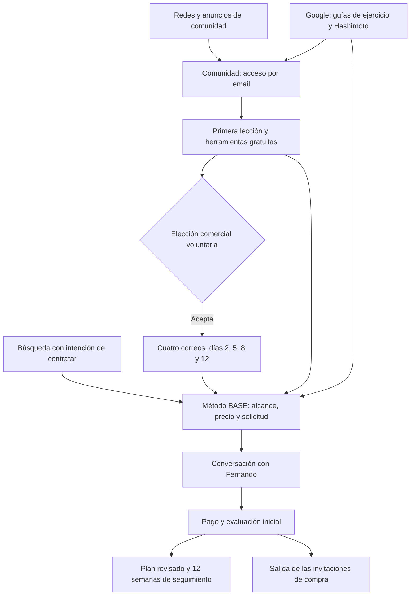

# Ecosistema de captación y correo · 5 de noviembre de 2026

Objetivo: convertir visitas interesadas en solicitudes válidas y clientas de Método BASE Tiroides. Prioridad: mujeres con hipotiroidismo o Hashimoto en España. Los vídeos siguen pendientes; ningún paso necesita una grabación.

La captación anterior ya está publicada. Los ajustes de esta tanda están preparados en la rama `feat/email-ecosystem` del checkout `wellnessreal-cookie-publish`. El checkout principal conserva sus cambios. La preparación de MailerLite sí existe en la cuenta real, pero permanece sin contactos nuevos, sin programación y sin activar.

## Recorrido y destinos



| Tráfico | Página principal | Próximo paso |
| --- | --- | --- |
| Redes, biografía y anuncios para conocer a Fernando | `/comunidad/entrar` | Acceso gratuito y primera acción |
| Búsqueda informativa | `/hipotiroidismo/ejercicio` y `/hashimoto/entrenamiento` | Resolver la duda; comunidad o programa |
| Búsqueda de acompañamiento | `/metodo-tiroides` | Consultar alcance y precio; solicitar conversación |

Las cuatro páginas devolvieron HTTP 200 en la comprobación pública. Los textos de anuncios, enlaces con UTMs y calendario de reutilización están en [material de captación](../../content/guiones/ecosistema-captacion-2026-11.md). Son borradores: no se ha contratado tráfico ni asignado presupuesto.

## Qué correo corresponde a cada sistema

| Momento | Sistema existente | Situación |
| --- | --- | --- |
| Enlace de entrada a la comunidad | Supabase Auth | Se solicita al escribir el email; se confirma al abrir el enlace |
| Bienvenida de un perfil nuevo | Correo de la aplicación | Una sola bienvenida; no suscribe a publicidad |
| Entrega de guías y newsletter anterior | Aplicación y MailerLite, según formulario | Se conservan los recorridos existentes |
| Ideas e invitación al programa desde la comunidad | Nuevo grupo de MailerLite | Elección separada, casilla sin marcar; recorrido comercial desactivado |
| Solicitud, pago, aprobación del plan, check-ins, revisiones y cierre | Aplicación; Resend si está configurado, Gmail como alternativa | Recorrido existente con estados y control de reintentos |
| Avisos de planes por revisar y entregas dudosas | Correo a `info@wellnessreal.es` | Revisar también el panel; un envío dudoso puede haberse entregado |

Producción tiene declaradas `RESEND_API_KEY` y `MAIL_FROM`, además de las variables de Gmail. Se comprobó su presencia, sin extraer sus valores. El entorno local utiliza Gmail si no hay clave de Resend. La presencia de variables no demuestra entrega real: esa prueba sigue pendiente. El cron existente se programa diariamente a las 09:00 UTC y procesa el acompañamiento y los segundos pagos; no se ha invocado manualmente.

**El envío de acceso de Supabase necesita su propia configuración SMTP.** Las variables de Resend en Vercel no configuran ese transporte. No se ha podido verificar el SMTP ni la plantilla del proyecto desde el panel en esta sesión, por lo que no se da por confirmado ni por ausente. Antes de invertir en captación, comprobar en Supabase el SMTP, remitente y URL de redirección a `/comunidad/confirmar`, además de una recepción real con una cuenta propia. El servicio SMTP de prueba de Supabase tiene restricciones y no se recomienda para producción; véase la [documentación de SMTP](https://supabase.com/docs/guides/auth/auth-smtp). No se han cambiado plantillas ni autenticación.

## Recursos reales preparados en MailerLite

Remitente y respuesta de los nuevos borradores: **Fernando · WellnessReal**, `info@wellnessreal.es`. Idioma de campaña: español (`8`).

| Recurso | Nombre | Identificador y estado |
| --- | --- | --- |
| Grupo | WR Comunidad · Suscripción voluntaria | `203311548630828365` · vacío |
| Automatización | WR Comunidad · Recorrido 14 días · Borrador 2026-11 | `203311548753511896` · inactiva, sin pasos ni disparador |
| Correo día 2 | Tu primer paso con la fuerza | `203311548999927399` · borrador |
| Correo día 5 | Una semana difícil también necesita un plan | `203311550237247377` · borrador |
| Correo día 8 | Cómo entiendo el entrenamiento y el seguimiento | `203311551433672134` · borrador |
| Correo día 12 | ¿Te ayudaría un plan adaptado con seguimiento? | `203311552609126286` · borrador |

Los cuatro HTML fueron aceptados y consultados de nuevo: contenido diseñado, sin datos obligatorios pendientes según la API y sin fecha de envío. Se asignaron exclusivamente al grupo nuevo y vacío. **Son campañas en borrador que sirven de contenido para montar los correos de la automatización; todavía no son pasos conectados a ella.**

Se pueden consultar desde [WellnessReal → Email → Campañas](https://wellnessreal.es/admin/email/campaigns), con la sesión de administrador, o desde la cuenta de MailerLite. Buscar los nombres «WR Comunidad · Día N · Borrador 2026-11».

Se conserva la automatización activa «Grupo Tiroides - Bienvenida», su grupo `tiroides` y los borradores anteriores. No se han importado ni incorporado sus contactos al nuevo recorrido.

La exportación local incluye HTML, texto, manifiesto y una portada de revisión en `output/email-ecosystem-20261105/index.html`. Se regenera con `node scripts/prepare-community-email.mjs`, sin escrituras remotas. Solo el parámetro explícito `--prepare-provider` prepara recursos remotos; no dispone de acciones para programar, enviar o incorporar contactos. Los resultados locales están excluidos de Git.

## Ajustes de la aplicación

- La suscripción de comunidad exige sesión aprobada, coincidencia con el email verificado y elección expresa. El email del formulario es de solo lectura. Una clienta con acceso al programa queda excluida, también si intenta llamar directamente a la API.
- Si falla la consulta del acceso, no se interpreta como miembro gratuito ni se incorpora a campañas.
- Las bajas, rebotes y suscripciones sin confirmar de MailerLite no se reactivan. Volver a guardar una preferencia no repite la incorporación al mismo grupo.
- La preferencia queda en el CRM con fecha, versión y estado: `held` (retenida con el recorrido apagado), `pending` (proveedor no disponible), `suppressed` (dirección no activa) o `synced` (grupo confirmado). No se promete un envío al guardar la elección.
- No se envían puntuación ni perfil del test a MailerLite desde la captura del test. No se han borrado campos históricos ni alterado resultados guardados en la aplicación.
- La confirmación de pago mantiene la fecha de primera conversión y actualiza la fase comercial a «Pago confirmado». Los contactos marcados como pruebas siguen separados.
- La confirmación manual de asesoría pagada y la concesión de acceso manual también solicitan retirar el grupo de invitaciones. Un fallo posterior a un acceso concedido no lo revoca; revisar el error y reintentar la exclusión. Stripe conserva el reintento del webhook.
- La entrada directa desde anuncios permite elegir cookies antes de conservar UTMs. Solo se guardan códigos de campaña admitidos, con consentimiento; se excluyen tokens, emails, identificadores publicitarios y el enlace de confirmación. Se mantiene el primer origen conocido.
- Los fallos de envío de acceso ofrecen un reintento o el contacto de ayuda, en lugar de pedir al visitante que configure el proveedor. Se conserva el límite de tiempo cuando el proveedor lo especifica.

En la consulta de lectura realizada no había preferencias registradas con la versión `community-email-2026-11-05`, en ninguno de esos estados ni sin estado. Esto no equivale al número total de miembros o consentimientos antiguos y no autoriza a incorporar la lista histórica.

## Lo que falta para activar

1. **Confirmar dirección postal profesional y cuenta propia de prueba.** El pie redactado tiene marca, motivo de recepción, baja, privacidad y contacto. Falta verificar el domicilio configurado en MailerLite y que aparezca en el envío final. No se inventará una dirección ni se usará un domicilio personal sin indicación.
2. **Montar el recorrido en el panel de MailerLite.** La API pública permite crear la automatización vacía, pero no configurar sus pasos. Seleccionar el nuevo grupo como disparador, dejar la repetición desactivada y marcar la opción de sacar del recorrido cuando se abandona el grupo. No duplicar la bienvenida transaccional.
3. **Añadir los correos:** esperar 2 días → día 2; esperar 3 → día 5; esperar 3 → día 8; esperar 4 → día 12. Copiar los contenidos de los borradores preparados a los pasos del editor. Los días se cuentan desde la suscripción comercial, aunque la entrada a la comunidad fuese anterior. Se puede añadir una espera final de 2 días y retirar el grupo para cerrar el recorrido; no dar de baja a la persona de otras comunicaciones.
4. **Comprobar permanencia en el grupo y estado activo antes de enviar.** La retirada al pagar necesita esa configuración de salida para cancelar los pasos futuros. Probarla con una cuenta propia; no basta con comprobar que el contacto desaparece del grupo.
5. **Publicar los ajustes y configurar el grupo con el interruptor apagado:**

   ```dotenv
   MAILERLITE_COMUNIDAD_GROUP_ID=203311548630828365
   COMMUNITY_EMAIL_SEQUENCE_ENABLED=false
   ```

   En la revisión inicial estas variables no estaban declaradas en producción. No se han cambiado durante esta preparación.
6. **Prueba real controlada:** acceso y confirmación de comunidad, consentimiento comercial, recepción de un correo de prueba, respuesta a `info@wellnessreal.es`, baja y permanencia del acceso gratuito. Con la misma cuenta, comprobar la salida al conceder acceso de prueba al programa. No realizar un cobro real para probarlo ni incorporar clientas existentes a la secuencia.
7. **Activar solo después de revisar el resultado:** automatización del panel y `COMMUNITY_EMAIL_SEQUENCE_ENABLED=true` en el entorno adecuado. El interruptor de la aplicación controla incorporaciones nuevas; por sí solo no detiene correos ya programados en MailerLite. Para parar un recorrido activo, pausarlo también en el proveedor.

SPF incluye MailerLite y el selector DKIM de MailerLite resuelve correctamente. DMARC está en modo de observación (`p=none`). Esto no garantiza la bandeja de entrada; no se han cambiado registros DNS.

La revisión automática de herramientas detuvo el manejo del panel porque no pudo verificar la URL del navegador. La preparación se completó hasta lo permitido por la API pública; los pasos que requieren el panel siguen pendientes. No se ha intentado eludir esa comprobación.

## Operación y medición

Revisar solicitudes en el CRM y registrar contacto, conversación, propuesta y cierre reales. Priorizar solicitudes válidas, conversaciones, clientas e ingresos. Cuando se contrate tráfico, comparar coste por solicitud válida y por clienta. Las aperturas de correo no bastan para decidir rentabilidad.

Las preferencias `held` o `pending` necesitan revisión antes de incorporar personas; esta tanda no añade un importador ni un nuevo cron de marketing. No importar todos los miembros. `suppressed` exige respetar el estado del proveedor. La atribución con consentimiento representa una muestra, y no enlaza automáticamente distintos dispositivos.

Comprobación de lectura reproducible: `node scripts/audit-email-readiness.mjs`. Consulta DNS, estados de los recursos preparados, recuentos de preferencias y respuestas de las páginas públicas. No envía correos ni devuelve una lista de direcciones.

## Verificación

Pruebas unitarias: **100 correctas**, incluidos consentimiento, supresión, fallos de proveedor, pagos repetidos, acceso manual y CRM. Se comprobaron **36 casos de navegador** en Chrome móvil y escritorio; tras el ajuste de contraste se repitieron los seis casos del nuevo recorrido de correo. La entrada se revisó en 320, 375 y 1440 px; los cuatro HTML locales en 375 y 600 px. Sin desbordamientos ni incidencias WCAG detectadas por Axe en esas superficies. El detector de diseño no encontró incidencias en la pasada sobre los componentes modificados. **TypeScript, lint y compilación de producción correctos**; comprobación de contenido publicado: **59 artículos y 59 imágenes, sin incidencias**. Se usa un servicio local con perfiles ficticios y bloqueo de correo externo. Ninguna prueba local acredita entrega real, baja efectiva en un envío real ni configuración de pasos en MailerLite.

Referencias: [API de automatizaciones](https://developers.mailerlite.com/api/automations), [campañas](https://developers.mailerlite.com/api/campaigns), [suscriptores](https://developers.mailerlite.com/api/subscribers), [grupos](https://developers.mailerlite.com/api/groups) y [disparadores y salida del grupo](https://www.mailerlite.com/help/how-to-set-up-automation-triggers).
